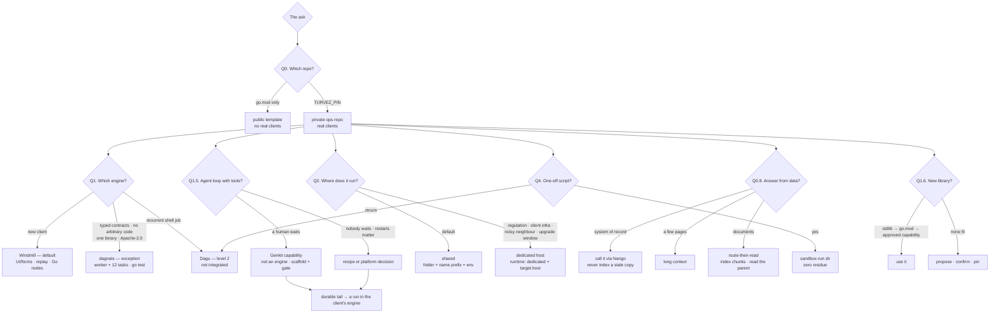

# turvez — the solo consultancy runtime for durable client automations

Turvez is built for forward-deployed engineers: client work that survives
failures, waits for humans, and keeps receipts. Source lives in git — your
agent drafts it, tests gate it, you approve. One folder per client, extractable
to dedicated infra when they grow. Your own automations run free on the same
spine.

The repo is **not** the runtime. It is the **spine**.

**Spine** = the client contract, source of truth, gates and evals.

**Engine (per client)** — recorded in `clients/<client>/client.yaml`:

| Choice | Gets |
| --- | --- |
| **Windmill** — default | most automation work |
| **dagnats** — exception | typed, audit-friendly, no arbitrary code |
| **Dagu** — level 2 | script-shaped jobs only |

**Layers** sit around the engine and never become a second orchestrator:

- **Nango** — credentials and agent tools
- **LLM gateway** — model calls
- **Retrieval** — documents

## The stack at a glance

| Layer | What it is | What it serves | Where it runs |
|---|---|---|---|
| **Spine** (this repo) | `clients/<client>/`, `client.yaml`, fieldbook, `env/` + age, evals, gates | source of truth, tenancy, review, rollback | git — public template / private ops |
| **Windmill** — default engine | flows under `automation/windmill/`, Go script nodes, UI/forms, step-level replay | most client work; an operator who is not you | one instance, one workspace per client |
| **dagnats** — exception engine | Go worker + 12 generic tasks + embedded NATS JetStream, `go test` gate | typed contracts, native approvals, no arbitrary code, one binary, Apache-2.0 | one binary; shared or dedicated |
| **Dagu** — level 2 | YAML DAGs over commands the client already has | recurrent script/SSH/Docker/backup jobs | separate binary, no DB; source under `automation/dagu/`, deployed to a dags dir |
| **Nango** — credential/tool layer | OAuth store, HTTP proxy, Agent Sessions (MCP) | SaaS auth without raw tokens; tool discovery for agents | Node + Postgres; **one instance per client** by default, Cloud or a shared pilot broker on request (`docs/access-plane.md`) |
| **LLM gateway** | OpenAI-compatible endpoint behind `llm.complete` | one auditable model-call surface, per-client keys/cost | per deployment profile |
| **Genkit** — optional capability, not an engine | bounded, human-watched agent loop in a Go service (`cmd/<client>-agent`) | review/rewrite, triage with read-only tools, extraction with a critic; goai is still the only model path | scaffolded per client (`scripts/new-agent-service.sh`), in front of its engine |
| **Retrieval** — per-client capability | long context, or Go + [Bleve](https://github.com/blevesearch/bleve): index ~256-512-token chunks (the routing unit), **read their parent section (the reading unit)** under hard token/candidate caps (`docs/retrieval.md`). **PageIndex** (tree index + LLM traversal, MIT) is an eval-gated alternative for long hierarchical documents needing multi-hop/ exact page traceability. | answering from documents; a calibrated cutoff refuses rather than filling the prompt with noise | alongside the client's engine |
| **Local inference** — optional, eval-gated | Ollama/vLLM (1-3B query rewrite) + ONNX reranker (MiniLM/BGE) | semantic expansion/reranking without sending content to a third party | shared service on the internal network; one per environment |
| **Evals** | promptfoo + `select-cases.py` / `windmill-job-to-run.py` | quality gate before and after a change | local / CI |
| **Sandbox** | `scripts/sandbox-run.sh` | one-off scripts, zero residue | local Docker |

**One orchestrator per client.** Nango, the gateway and retrieval are layers:
they sit in front of Windmill or dagnats, they do not replace either. Running
two engines for one client is a test failure (`TestClientManifests`).

## Related tooling (evaluated, not installed)

Every one of these is a **layer or an alternative** for a slot this stack
already fills. They are listed so a future decision starts from facts instead
of from a README claiming "open source". Full comparison, licences and
triggers: `docs/tooling.md`.

| Tool | What it does | When it would enter | Today |
| --- | --- | --- | --- |
| **Corsair** | Apache-2.0 credential broker: ~300 provider plugins, REST + MCP, per-tool approvals, multi-tenant | If Nango's Elastic-2.0 terms block a use and a Node sidecar is acceptable | Not installed — same role as Nango |
| **ACI.dev** | Apache-2.0 tool-calling platform: 600+ tools, per-user OAuth, natural-language permission boundaries, tool-use logs, unified MCP server + portal | When the access plane wants a ready tool catalog and MCP surface, and a Python service is acceptable | Not installed — a P3 adapter candidate, not a recipe proxy |
| **agentgateway** | MCP/A2A data plane: CEL policy, credential injection on egress (CB4A model A), guardrails | When *we* host MCP servers and need per-call policy plus injection | Not installed — no MCP traffic to police |
| **Executor** | MIT agent-first app host: MCP gateway, per-app accounts, tool approvals, one container | Only if we accept an external app host beside the spine | Not installed — different product shape |
| **Bifrost** | LLM gateway: provider unification, failover, semantic cache, virtual keys and budgets | When the LLM key is **ours** (resale/budget per end user) or failover has an SLA | Not installed — the client owns their key, GoAI is the only model path |
| **OpenBao** | Secrets service: KV, dynamic DB credentials, PKI, audit devices | 3+ operators on client secrets, a regulated client demanding an access audit trail, or an agent gateway's vault | Not installed — age covers at-rest encryption with no service to unseal |

## Access plane (client agents calling tools)

Automations are one product; letting the client's own agents call the same
authenticated tools is another. It is a third plane — not control, not
execution — and it lives in `access:` in `client.yaml` plus a ceiling in
`catalog/policy.yaml`.

- **Policy in git** and reviewed; **connections and grants in the broker**, so
  connecting an app that is already allowed needs no PR.
- `go test ./clients/` refuses:
  - a write with no approval;
  - a `sensitive` client off the client-hosted plane;
  - a `cloud` plane on our account;
  - a provider used but not declared;
  - an `identity` left unstated.
- One broker per client is the default (`NANGO_CLIENT_ID`); `--shared` is a
  `data_class: normal` pilot.
- `identity: org` is the recommendation — one refresh chain, one revocation
  row; `per-user` is a compliance choice, not an upgrade.
- P2-B ships as `cmd/access-plane` (grant/list/revoke/audit) over the Nango
  adapter and the grant manager.

Design and phases: `docs/access-plane.md`.


## Decision tree

Canonical tree, the interview protocol (read first, ≤3 branch-flipping
questions, every one carrying a recommendation, the answer recorded) and the
defaults table: `skills/turvez/references/decision-tree.md`. Full rationale:
`docs/client-spine.md`, `docs/script-execution.md`,
`docs/deployment-profiles.md`, `docs/retrieval.md`, `docs/genkit.md`.

Rendered on GitHub; the text form for terminals, diffs and agents is the
canonical tree (`skills/turvez/references/decision-tree.md`).



**Hard defaults** — the facts that settle most asks, and the only row an
interview changes:

- One orchestrator per client; `client.yaml` wins once it exists. Never two
  engines.
- Windmill unless a contract criterion says dagnats; Dagu is level 2 only.
- Shared host and profile B (managed) unless regulation, client-owned infra, a
  noisy neighbour or a per-client upgrade window says dedicated.
- Call a system of record at the source; for documents, index chunks and read
  the parent, under a hard token budget with a calibrated refusal — vectors only
  behind an eval.
- Genkit only when a human watches the loop; the durable result becomes a run in
  the client's engine.
- A new library goes stdlib → `go.mod` → approved capability → propose and
  confirm; then `go.mod` pins and Dependabot keeps it current.

## Repo structures

### Template repo (public)

```text
cmd/worker/                 dagnats worker binary (engine-specific)
internal/handlers/          the 12 stable tasks
internal/secret/            env + age loader
internal/opshttp/           human-approval shim
clients/_template/          skeleton: client.yaml, FIELDBOOK, recipes, evals
clients/example-client/     worked example (dagnats + recipes)
clients/ops/                platform automations (DLQ watchdog)
clients/personal/           your own namespace
env/<client>.env.example    secret NAMES (committed)
secrets/<client>/           age recipients + ciphertext
engines.json                engine policy; "default": "windmill"
scripts/                    scaffolds, gates, extraction, evals
docs/ skills/               references; the skill is the agent entry point
```

The template keeps only `_template/`, `example-client/`, `ops/`, `personal/`.
A real client name fails `TestNoRealClientsInTemplate` and must move to the ops
repo (`docs/ops-repo.md`).

### Ops repo (private, `turvez-ops`)

```text
TURVEZ_PIN                  pins the template release (tag, not a branch)
clients/<client>/           real clients, one folder each
env/<client>.env.example    names only; values in .env (gitignored) or age
secrets/<client>/           age recipients and env.age
workflows/                  legacy phase-1 layout, read-only during migration
```

Validate from the template checkout:

```bash
OPS=$PWD; cd $TURVEZ_CHECKOUT && WORKFLOWS_DIR=$OPS/clients go test ./clients/
```

### Per client (engine-agnostic)

```text
clients/<client>/
  client.yaml               engine: windmill|dagnats|dagu
                            runtime: shared|dedicated, target, data_class, owner
  README.md                 fieldbook: context, contacts, systems, triggers, runbook
  automation/<engine>/      the active source; exactly one engine directory
  evals/                    promptfoo config, cases, labels
```

The engine changes the source directory and the deploy command, not the folder
shape, the fieldbook, the evals or the tenancy rules.

## Clients and scales

**Client kinds.** `example-client/` is the worked fixture; `ops/` holds platform
automations; `personal/` is your own namespace with you as approver; real
clients live only in `turvez-ops`. All four follow the same pipeline and gates.

**Shared → dedicated.** Isolation is a deployment profile, not a repo fork and
not an engine change. Only `runtime` and `target` change; source, evals and the
secrets schema stay. `scripts/verify-isolation.sh` reads the manifest and fails
a `dedicated` client with no `target.host`; `scripts/extract-client.py` prints
the cutover plan (definitions from git, triggers to disable, commands and
rollback). Procedure: `docs/isolating-a-client.md`.

**Tenancy stages** (`docs/tenancy-evolution.md`):

1. Single server: folder + name prefix + env per client (default).
2. Logical multi-tenant: prefix-checked registration, optional per-client
   approval tokens.
3. Physical: copy the folder + env to a new host, re-register, repoint
   webhooks, disable on the old one.

**Deployment profiles** (`docs/deployment-profiles.md`):

| | A. Embedded | B. Managed (SMB default) | C. Multi-tenant |
|---|---|---|---|
| Runs on | client's server | your server, one stack per client | your server, one stack for many |
| Boundary | data stays with client | crosses to you — needs DPA | crosses; tenant isolation required |
| Gateway | only if 2+ callers | one, virtual key per client | required, per-tenant limits |
| Windmill cost | Postgres + workers in their infra | one workspace per client | one instance, workspace per tenant |
| dagnats cost | one binary + container | one stack per client | one stack, tenant-scoped names |

**Solo → team.** Append an operator's age public key to
`secrets/<client>/.recipients`; they decrypt only their clients. Move to `sops`
when per-client recipients become routine, not before (`docs/secrets.md`).

## Quickstart

```bash
# 0. Skill (agent entry point)
npx skills add calionauta/turvez --skill turvez -g

# 1. Prereqs and env templates
./scripts/setup.sh
./scripts/setup.sh --init personal

# 2. Create a client in the ops repo (never in the public template)
./scripts/new-ops-repo.sh ../turvez-ops
TURVEZ_OPS_DIR=../turvez-ops ./scripts/new-client.sh acme              # Windmill
TURVEZ_OPS_DIR=../turvez-ops ./scripts/new-client.sh acme --engine=dagnats

# 3a. Windmill path (default) — gates run from the template, against the ops repo
TURVEZ_OPS_DIR=../turvez-ops ./scripts/check-windmill.sh
TURVEZ_OPS_DIR=../turvez-ops ./scripts/lint-scripts.sh   # compiles Go nodes
wmill flow preview ../turvez-ops/clients/acme/automation/windmill/<flow>
wmill flow push ../turvez-ops/clients/acme/automation/windmill/<flow> "f/acme/<flow>"

# 3b. dagnats path (exception)
make up                              # dagnats :4222/:8080 + worker
make register                        # example recipes
make smoke

# 4. Gates
make validate
go test ./...
```

Console: `http://127.0.0.1:${DAGNATS_HTTP_PORT:-8080}/console/` (basic auth,
`DAGNATS_CONSOLE_PASSWORD`). Evals: `make eval-client CLIENT=<id> …`; UI
`:15500`. Full walkthrough with traps: `docs/first-run.md`.

## Operator loop

1. **Direct first.** Read the client's fieldbook and `client.yaml`; decide the
   engine, runtime and level (`docs/script-execution.md`). A new client starts
   on Windmill unless a criterion says otherwise.
2. **Build in the client's engine.** Windmill: Go script nodes + `flow.yaml`
   under `automation/windmill/` (`docs/language-policy.md`). dagnats: a JSON
   recipe over the 12 tasks under `automation/dagnats/`. Dagu: level 2 only.
3. **Validate locally.** `make validate` + `go test ./...`; Windmill also
   `./scripts/check-windmill.sh` and `./scripts/lint-scripts.sh`.
4. **Deploy with confirmation.** dagnats: propose `register`, wait. Windmill:
   `wmill flow preview`, then push one flow; never `wmill sync push`.
5. **Observe and evaluate.** `on_failure` → notify, `ops/dlq-watchdog`,
   external `GET /health`; then generate cases and run the eval loop.

## Examples

| Example | Engine | Flow |
|---|---|---|
| `new-client.sh` Windmill scaffold | Windmill | `example-flow` with a Go node (`func main() (interface{}, error)`) |
| `hubspot-lead-to-slack` | dagnats | webhook → Nango proxy → transform → Slack |
| `invoice-paid-route` | dagnats | fetch → transform → `skip_if` VIP/standard split |
| `nightly-sync` | dagnats | embedded cron, static first step |
| `approval-refund` | dagnats | native `approval` gate (48h) → refund POST → receipt |
| `personal.ping` | dagnats | no-op smoke for your namespace |

Human approval from Slack/email: point the button at the ops shim
(`internal/opshttp`, `OPS_HTTP_ADDR=127.0.0.1:8090`):

```bash
curl -X POST localhost:8090/ops/approvals/<run-id> \
  -H "Authorization: Bearer $OPS_APPROVAL_TOKEN" -d '{"approved":true}'
```

## Docs

- `docs/client-spine.md` — the spine: one repo, per-client engine, shared/dedicated, migrations
- `docs/deployment-profiles.md` — A embedded / B managed / C multi-tenant, gateway placement, engine cost
- `docs/script-execution.md` — where to execute: recipe vs sandbox vs Dagu vs Windmill + platform comparison
- `docs/workflows.md` — Mermaid diagrams: repo choice, automation, eval loop, formats
- `docs/first-run.md` — verified install → client → run → observe → eval, with traps
- `docs/writing-recipes.md` — recipe anatomy, engine-vs-handler table, what the engine allows, v0.0.32 traps
- `docs/handlers-reference.md` — task inputs/outputs, metadata keys
- `docs/language-policy.md` — **Go script nodes**; TS/Python only for a dispatch-only WAC orchestrator
- `docs/nango.md` — credential layer: OAuth proxy, naming/enforcement, Agent Sessions (MCP)
- `docs/access-plane.md` — the third plane: client agents calling authenticated tools, policy vs state, where the broker runs, invariants, phases
- `docs/tooling.md` — when each layer enters (Nango, Corsair, agentgateway, Executor, Bifrost, OpenBao) and when it would be weight
- `docs/cloud-remotes.md` — `scripts/connect-remotes.sh`: record Windmill and Nango cloud/self-hosted endpoints (prompts, validates, never prints a secret)
- `docs/retrieval.md` — documents vs systems of record; route-then-read; hard token/candidate caps; calibrated refusal; eval gate
- `docs/genkit.md` — agent-loop capability (not an engine): a bounded Genkit flow in the request, goai as the only model path, Nango for tools, durable tail as a run; scaffold `scripts/new-agent-service.sh`, compile gate `scripts/check-agent-template.sh`
- `skills/turvez/references/decision-tree.md` — the canonical tree, the interview protocol and the defaults table
- `docs/secrets.md` — per-client age encryption, JIT runtime
- `docs/alerting.md` — `on_failure`, DLQ watchdog, external uptime probe
- `docs/tenancy-evolution.md` — stages 1→3 without redesign
- `docs/isolating-a-client.md` — extract one client to its own host
- `docs/ops-repo.md` — template (public) vs ops (private) split, lifecycle
- `docs/migrate-to-windmill.md` — step mapping + `scripts/convert-to-windmill.py`
- `docs/sandbox-policy.md` — when a sandbox is needed (usually not)
- `docs/observability.md` — what is stored, prompt persistence, retention
- `docs/agent-tools.md` — exact CLI/API for an authoring agent
- `clients/_template/FIELDBOOK.md` — per-client fieldbook template
- `skills/turvez/SKILL.md` — the automate-anything skill (direct → confirm → build)
- `ARCHITECTURE.md` — diagrams, components, data flow, decisions
- `AGENTS.md` — normative agent rules; `llms.txt` — task index

## Conventions

- Automation code = the engine's source in git. dagnats: JSON recipes over the
  12 tasks. Windmill: `flow.yaml` + Go script nodes. New Go handler = last
  resort + tests + human review; no arbitrary script execution from JSON.
- Script nodes are **Go** in both engines. TypeScript/Python only for a
  Windmill WAC orchestrator that dispatches to Go scripts (`docs/language-policy.md`,
  gate `./scripts/lint-scripts.sh`).
- Secrets by name in JSON. Provider OAuth/API keys live in **Nango** as a
  connection (`"auth_secret": "NANGO_SECRET_KEY"`, `docs/nango.md`); our own
  plumbing stays in env/age. Values never in JSON or the repo.
- Durations in dagnats JSON are integer nanoseconds (`30000000000` = 30s) or Go
  duration strings (`"30s"`).
- Secrets are age-encrypted from day one (`secrets/<client>/env.age`,
  `scripts/edit-secrets.sh`); plain `.env` files are local scratch only.
- Local hooks (pre-commit recipe scan + commit-msg Conventional Commits):
  `./scripts/install-hooks.sh`.
- Conventional Commits → release-please → tag + changelog. Ops repos pin
  `TURVEZ_REF=vX.Y.Z`, not a moving branch.
- Pre-1.0 by policy: 1.0.0 requires an explicit human decision; the version
  guard fails CI if the manifest crosses 1.0.0.
