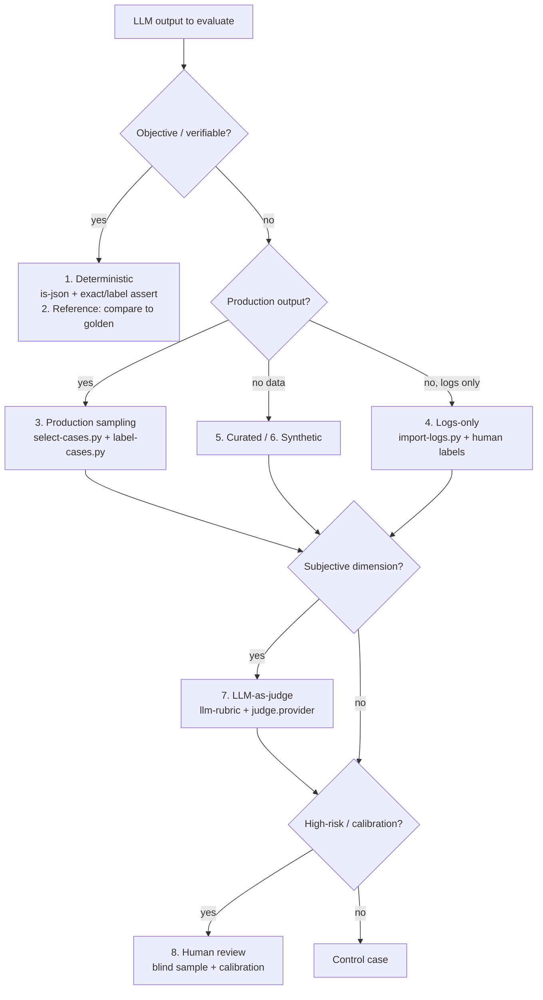

# Eval strategies: how to choose and run each method

Status: normative decision guide for evaluating LLM outputs. It adds no runtime
dependency and changes no script; it tells the authoring agent and the operator
**which strategy to use, when, and who does what**.

`docs/workflows.md` §3 shows the eval loop as a diagram.
`skills/turvez/references/eval-loop.md` is the agent procedure. This page is the
missing top rung: the selection of the method itself.

## The decision tree

Ask in order; the first **yes** decides.

**Q1. Is there an objective, verifiable correct answer?** (format, schema, exact
value, safety, policy, routing)
Yes → **Deterministic check** (§1). Code, not a model. If a golden reference is
known, the same check compares against it — reference-based eval (§2) is §1
with a human-authored stored reference, not a separate mechanism.
No → Q2.

**Q2. Is there production output to learn from?**
Yes → **Production sampling** (§3): `select-cases.py` + `label-cases.py`.
No, but there are logs/inputs → **Logs-only import** (§4): `import-logs.py` +
human labels.
No data at all → **Curated manual** (§5) and/or **Synthetic** (§6).

**Q3. Is the dimension subjective or open-ended?** (helpfulness, tone,
grounding, relevance)
Yes → **LLM-as-judge** (§7), only after deterministic + label are exhausted.

**Q4. Is the case high-risk, ambiguous, or needed to calibrate the judge?**
Yes → **Human review** (§8): blind sample, calibration set.

**Q3 and Q4 compose; they are not a chain.** A subjective, high-risk case gets
both: a judge that is calibrated by humans. Q4 applies regardless of Q3 — a
deterministic check can still need human calibration.



## Strategy catalog

| # | Strategy | When | Data source | Tool | Who |
|---|---|---|---|---|---|
| 1 | Deterministic | Objective, verifiable | schema + label taxonomy | `evalconfig.py`, promptfoo `is-json` / `javascript` | LLM writes, human confirms |
| 2 | Reference-based | Known golden answer | curated cases | `curated.yaml`, promptfoo asserts | human authors, LLM runs |
| 3 | Production sampling | Production runs exist | dagnats / Windmill runs | `select-cases.py`, `label-cases.py` | LLM selects, human labels |
| 4 | Logs-only | No production output | logs (JSONL/CSV/text) | `import-logs.py` | human labels |
| 5 | Curated manual | Coverage, edge cases, red-team | hand-written | `curated.yaml` / `curated.csv` | human authors |
| 6 | Synthetic | Real data scarce/private, edge coverage | generated (proposed) | *none yet* | LLM generates, human validates |
| 7 | LLM-as-judge | Subjective / open-ended | cases + rubric | `llm-rubric` + `judge.provider` | judge model, human calibrates |
| 8 | Human review | High-risk, calibration, disagreement | any | `label-cases.py --blind` | human |

---

## 1. Deterministic checks

**When**: the output has one correct interpretation — a date, an amount, a
category from a fixed set, a schema, a policy rule, a routing decision.

**Do**:
- Declare the schema in `eval.config.json` (`fields`, `schema_extra`) or inline
  in `curated.yaml`.
- Assert with `is-json` + `javascript`:
  `JSON.parse(output).category === '{{expected_category}}'`.
- Add `schema_extra` for fields that are validated but not labeled
  (e.g. `urgency`).

**Instructions for the LLM**: never use a rubric for a deterministic field;
write the assertion. If you cannot express it as a schema or an exact
comparison, it is not deterministic — go to Q4.

**Instructions for the human**: confirm the taxonomy (`label-cases.py
--setup`). A wrong value list makes every eval wrong.

## 2. Reference-based eval

**When**: there is a known correct answer — a golden answer, a policy, a
document section.

**Do**: this is §1 with a stored, human-authored reference. Put the expected
value in `curated.yaml` `vars` and assert equality. Citation and summary
asserts are hand-written in `curated.yaml`; `evalconfig.py`'s
`retrieval_fields` (answer / citation / refusal) is a labeling taxonomy,
not auto-generated assertions — `select-cases.py` does not emit them.

**Instructions for the LLM**: do not invent the reference. If a case needs an
essay, it is not a reference case.

**Instructions for the human**: author and own the golden answers; keep them in
`curated.yaml` with `metadata.split: holdout` for the cases you will not tune
on.

## 3. Production sampling

**When**: the automation has run in production and the eval should reflect
reality.

**Do**:

```bash
python3 scripts/select-cases.py --dagnats --out clients/<client>/evals/cases --include-ok 3
python3 scripts/label-cases.py --dir clients/<client>/evals
python3 scripts/select-cases.py --runs runs.json --out cases --strategy random --seed 7 --limit 50
```

`--strategy` picks the sampling mix: `targeted` (default, signal-first),
`random`, `diverse` (greedy shingle coverage), or `stratified` (per label /
gate / status stratum). `--seed` makes non-targeted strategies reproducible;
`--limit` caps the cases. See "Sampling strategy selection" below.

`select-cases.py` picks failures, retries, gate rejections and malformed
output, dedupes by content hash, and writes `selection.json` as the audit
trail. `--include-ok N` adds N clean runs as controls (with the default
`targeted` strategy these are the first N clean runs in file order — with
`--strategy` they are drawn from the sampled pool, see "Sampling strategy
selection"). Production output becomes a *suggestion*, never a label.

**Instructions for the LLM**: show the selection counts and reasons; ask before
continuing; treat production output as a suggestion; the selection is read-only.

**Instructions for the human**: label by exception — `enter` accepts the
production suggestion, a shortcut or number overrides, any other text becomes
a new taxonomy value; label 10–30, not everything; use `--blind` for a
calibration sample.

## 4. Logs-only import

**When**: the client has inputs (logs, tickets, messages) but no production
model output.

**Do**:

```bash
python3 scripts/import-logs.py --input logs.jsonl --text-field message --out clients/<client>/evals
# fill expected_category in cases/logs.csv
npx promptfoo eval -c promptfooconfig.logs.yaml
```

It never invents a label.

**Instructions for the LLM**: do not generate labels for this path; the human
fills `expected_category`.

**Instructions for the human**: fill the CSV; use `--split holdout` for the rows
you will not tune on.

## 5. Curated manual cases

**When**: coverage, edge cases, red-team, failure modes you already know, or a
new client with no production history.

**Do**: write `cases/curated.yaml` (rich asserts) or `cases/curated.csv`
(spreadsheet). Keep `metadata.source: curated` and `metadata.split: dev|holdout`.

**Instructions for the LLM**: may draft cases from a documented failure; a
human must approve and own them.

**Instructions for the human**: author, review, and keep the holdout set
untouched by tuning.

## 6. Synthetic data

**When**: real data is scarce, private, or lacks coverage of rare/adversarial
cases.

**Do**: *not implemented yet.* Proposed: `scripts/gen-cases.py` takes the
taxonomy and a seed corpus, generates candidate inputs (and optionally
candidate labels) for human review, and writes them as `curated.yaml` entries
with `metadata.source: synthetic`.

**Rules**: supplement, never replace, real data. Generate candidates for human
validation; never auto-label. Verify the synthetic distribution against a real
held-out edge set. Do not commit raw client data.

**Instructions for the LLM**: generate candidates and edge cases; mark them
synthetic; never present them as production cases.

**Instructions for the human**: validate, correct, and approve every synthetic
case before it enters the eval set.

## 7. LLM-as-judge

**When**: the dimension is subjective or open-ended and no deterministic check
or label is possible.

**Do**: enable `rubric` in `eval.config.json`, set `judge.provider`, and keep
the rubric string with `{{text}}` so it grades the case. Prefer categorical
scales over floats; decompose broad criteria into discrete checks.

**Instructions for the LLM**: set `rubric` only when no deterministic check is
possible; keep the rubric specific; never let the judge inherit the provider
(pin it under `defaultTest.options.provider`).

**Instructions for the human**: calibrate the judge against a blind human
sample; if judge–human divergence exceeds ~20–25%, recalibrate or drop the
rubric; monitor drift (60–90 days); keep judge cost under ~10–15% of production
LLM cost.

## 8. Human review and calibration

**When**: high-risk decisions, ambiguous cases, judge calibration, and
disagreement analysis.

**Do**: use `label-cases.py --blind`; keep a calibration set the model never
sees; document the failure case and generalize it into a deterministic check or
a curated case.

**Instructions for the LLM**: surface disagreements; never override a human
label.

**Instructions for the human**: label blind; be the anchor for the judge; feed
disagreements back as new deterministic checks.

---

## Sampling strategy selection

When Q3 says production sampling, choose the sampling mix:

| Strategy | What it catches | Status |
|---|---|---|
| `targeted` (failures, retries, gate rejections, malformed) | known failure modes | ✅ `select-cases.py --strategy targeted` (default) |
| `random` baseline | unknown unknowns, distribution drift | ✅ `--strategy random --seed N --limit K` |
| `diverse` (greedy shingle coverage) | coverage of distinct behaviours | ✅ `--strategy diverse` |
| `stratified` (by category / query type) | per-segment regressions | ✅ `--strategy stratified` (labels → gate → status) |
| active learning (uncertainty / decision boundary) | the model's weak spots | ❌ proposed |

Rule: targeted for known failures; random/diversity for coverage; stratified
for segment regressions; active learning for the long tail. Never sample only
from production success.

## Judge calibration and guardrails

- Deterministic first; rubric only when no label exists.
- The rubric must carry `{{text}}`; categorical scales; decomposed criteria.
- Rotate positions in pairwise comparisons; penalize verbosity; avoid a
  same-family judge.
- Calibrate against a blind human sample; correlation target > 0.85.
- Recalibrate monthly, or when the rubric/model changes, or when divergence
  exceeds ~20–25%.
- Judge cost < 10–15% of production LLM cost; reduce sampling or downgrade the
  judge when it is not.
- A green eval that never reached the gateway, or a rubric grading an empty
  prompt, is a failure — check the gateway log.

## Cadence

| Moment | What |
|---|---|
| Every PR | deterministic checks only (`is-json` + label) |
| Prompt / model / recipe change | full eval on the frozen case set |
| Production incident | new cases from the incident, then re-run |
| Periodic | refresh cases from production sampling; recalibrate the judge |
| Canary / online (proposed) | sample live traffic; score asynchronously |

## Instructions for LLMs (summary)

1. Read `eval.config.json` and `docs/observability.md` before generating.
2. Prefer deterministic assertions; use a rubric only when no deterministic
   check or label exists.
3. Use `select-cases.py` for production runs, `import-logs.py` for logs,
   `curated.yaml` for manual cases.
4. Never treat production output as ground truth; never invent labels.
5. Tag eval traffic (`x-eval-run`) and keep `max_tokens` in sync with the
   recipe.
6. Ask before running the eval (judge tokens cost money).
7. Never commit raw cases unless the recipe redacted before persisting.
8. Report per-assertion results; a green eval with no gateway traffic is a
   failure.

## Instructions for humans (summary)

1. Declare the taxonomy once with `label-cases.py --setup`.
2. Label by exception; use `--blind` for calibration samples; label 10–30, not
   everything.
3. Own the golden answers and the holdout set.
4. Review judge disagreements; recalibrate when divergence is high.
5. Keep synthetic cases clearly marked and approved.
6. Never commit raw client text.

## Mapping to existing scripts

| Need | Script |
|---|---|
| Production cases | `scripts/select-cases.py` |
| Label by exception | `scripts/label-cases.py` |
| Logs → CSV | `scripts/import-logs.py` |
| Config / schema | `scripts/evalconfig.py` |
| One-command loop | `scripts/eval-loop.py` |
| Windmill jobs → cases | `scripts/windmill-job-to-run.py` |
| Decision-tree behaviour | `scripts/decision-eval.py` |

## Gaps and roadmap

- [ ] `scripts/gen-cases.py` — synthetic case generation with human approval.
- [x] Random / diversity / stratified sampling in `select-cases.py` (`--strategy`, `--seed`, `--limit`).
- [ ] Judge calibration tracking (human agreement, drift, cost).
- [ ] Online / canary sampling.
- [ ] Reference-based comparison beyond exact labels (citation validity,
      summary equivalence).

## References

- `docs/workflows.md` §3 — the eval loop diagram
- `skills/turvez/references/eval-loop.md` — the agent procedure
- `clients/_template/evals/README.md` — file ownership
- `docs/observability.md` — what is stored; schema gates
- `docs/retrieval.md` — retrieval eval and eval-gated alternatives
- `docs/access-plane.md` P4 — tool-selection evals
- `skills/turvez/evals/` — decision eval (behavioural)
