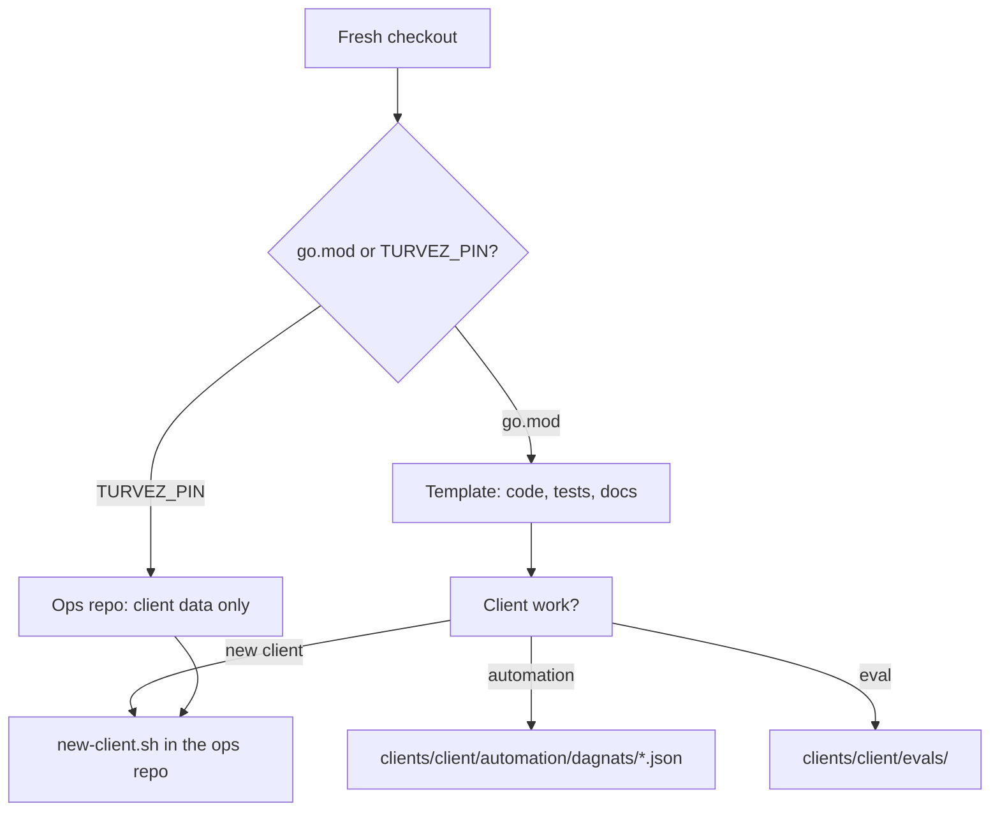
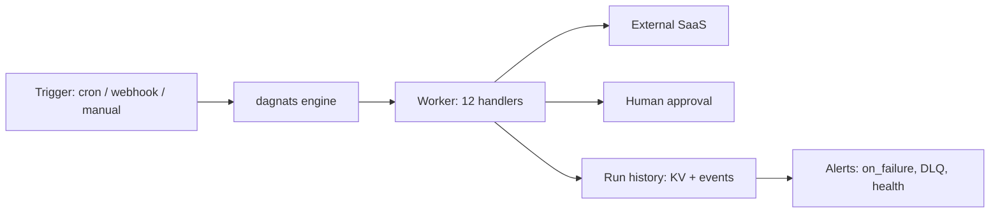
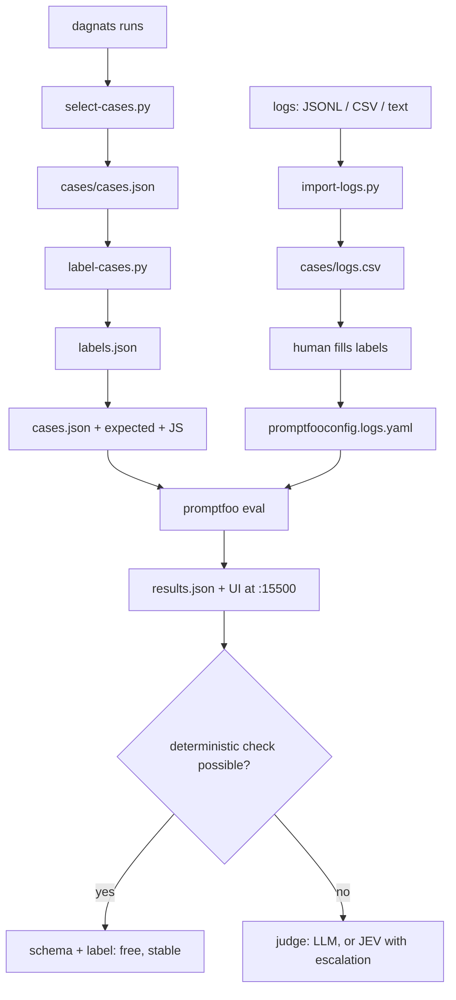
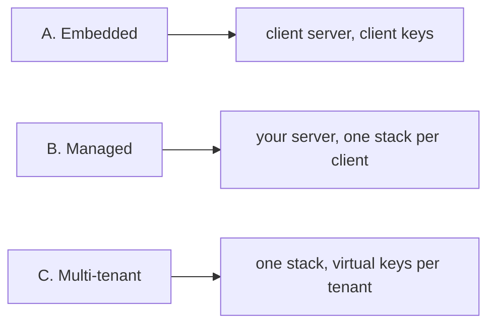
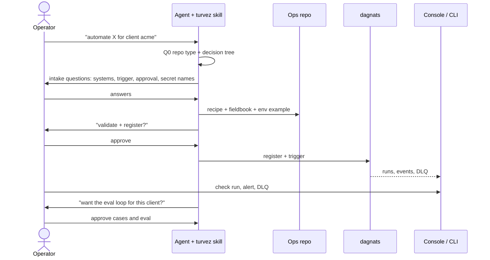

# Workflows

The paths through the repo, as diagrams. GitHub renders Mermaid.

## 1. Which repo am I in, and what am I doing?

`new-client.sh` scaffolds `clients/<client>/`, `env/<client>.env.example`,
`secrets/<client>/` and `clients/<client>/evals/` in one pass.

## 2. Automation: build, run, observe

A recipe is JSON in `clients/<client>/automation/dagnats/`. Git is the source; `workflow
register` puts it in the engine. Every run keeps its input and each step's
output, which is what the eval reads.

## 3. Eval loop: from runs or logs to a measured dataset

Use the run path when the automation already calls a model: production output
becomes a *suggestion*, not a label. Use the logs path when the client has only
inputs: labels are human from the start.

## 4. Deployment profiles

Details and gateway placement: `docs/deployment-profiles.md`.

## 5. Operator flow: from request to production

What the operator does, what the agent does, and where to check.

| Step | Operator | Agent | Where to check |
|---|---|---|---|
| 1. Ask | describes the integration in natural language | loads `turvez` skill, Q0, decision tree | the agent's answer |
| 2. Intake | answers systems, trigger, approval rule, secret **names**, alert channel | asks, then writes the fieldbook | `clients/<client>/README.md` |
| 3. Build | reviews the recipe | writes JSON, runs `validate` + `go test` | repo diff |
| 4. Secrets | puts values in `env/<client>.env` or age | never writes values | `env/`, `secrets/` |
| 5. Go live | approves `register` + `trigger` | runs them | `/console/workflows/<client>.<wf>` |
| 6. Operate | checks runs, DLQ, alerts | explains failures | console, `dagnats run list`, Slack/Telegram |
| 7. Eval | labels cases, approves the eval | generates cases, runs promptfoo | `results.json`, `:15500` |

The operator never has to memorize commands. They ask for the outcome; the
skill drives the sequence. The two hard rules are **approve side effects** and
**provide secret values only through env/age**.

## Formats: pick by role, not by taste

| Role | Format | Why |
|---|---|---|
| Raw logs to import | **JSONL**, CSV, plain text | JSONL is the common structured-log shape; one record per line, streams without loading everything |
| Generated cases | **JSON** (`cases/cases.json`) | machine output from `select-cases.py`; never hand-edited |
| Hand-written cases | **YAML** (`curated.yaml`) | comments, multi-line text, per-case assertions |
| Label worksheet | **CSV** (`logs.csv`) | spreadsheets; one row per input, empty `expected_category` |
| Labels for generated cases | **JSON** (`labels.json`) | script-owned map keyed by input hash |
| Promptfoo config | **YAML** | native format, supports comments |
| Per-client eval config | **JSON** (`eval.config.json`) | small, parsed by the scripts without extra dependencies |
| Results | **JSON** + HTML | machine-readable and human-readable |

In short: **JSONL for machine logs, CSV for human tables, YAML for authored
text, JSON for generated artifacts.** promptfoo accepts all of them, so the
choice is about who edits the file and how it diffs, not compatibility.
