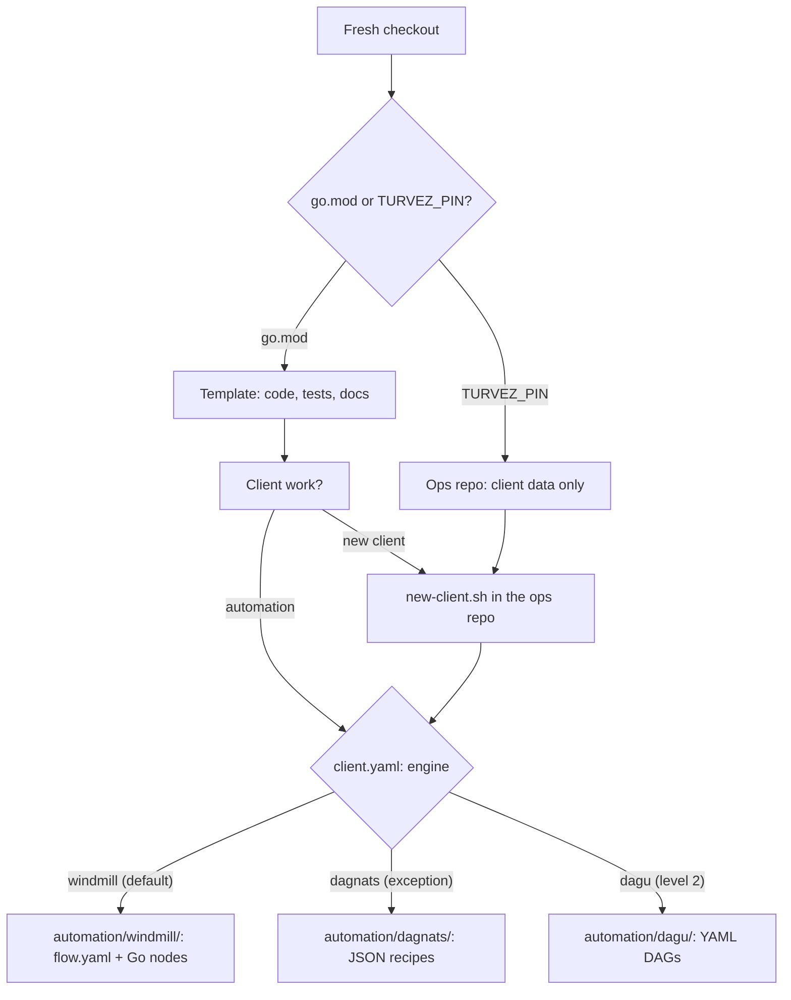
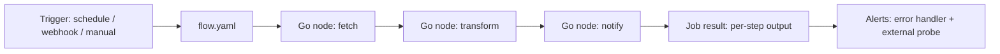
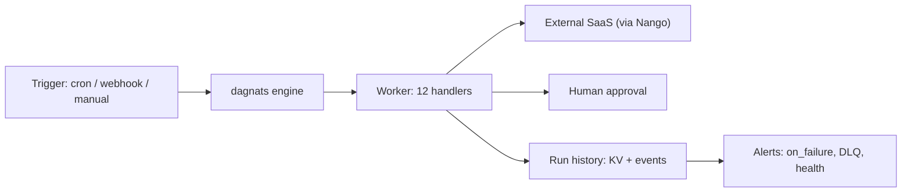
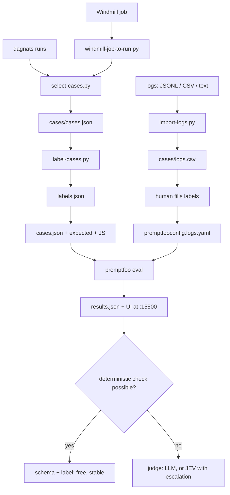
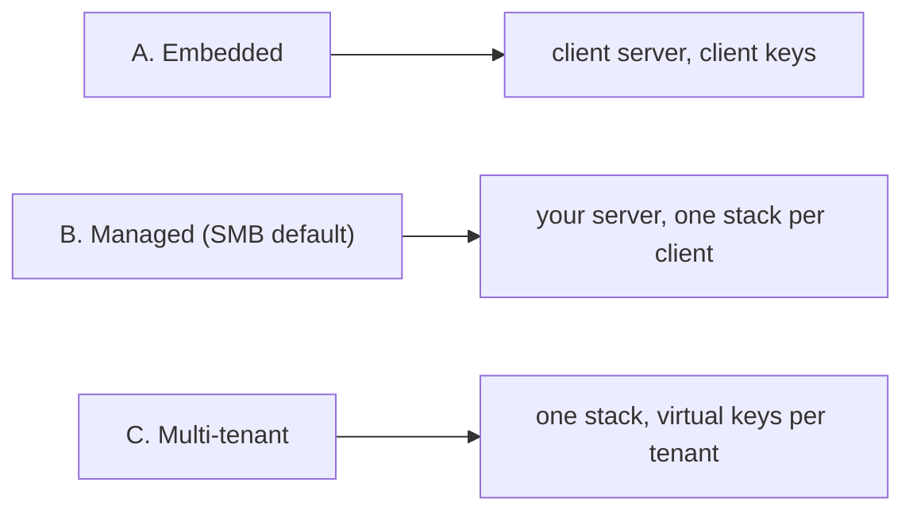
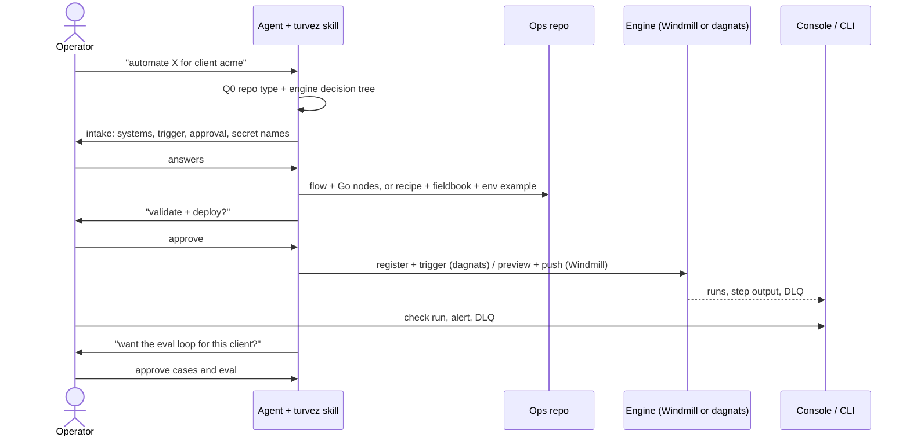
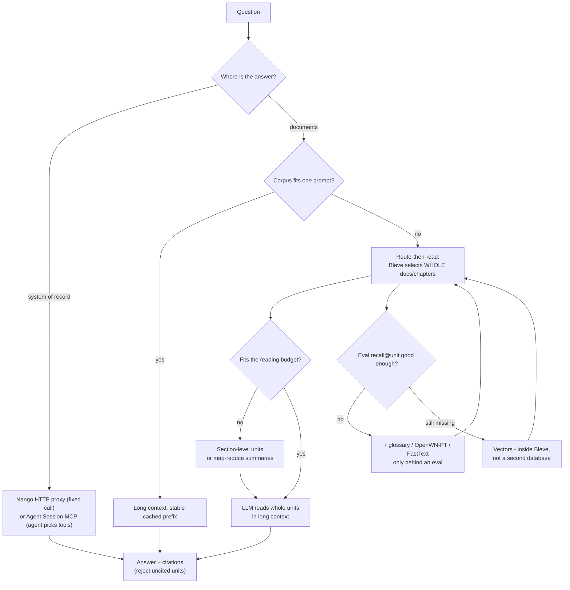

# Workflows

The paths through the repo, as diagrams. GitHub renders Mermaid.

## 1. Which repo am I in, and which engine?

`new-client.sh` scaffolds `clients/<client>/`, `env/<client>.env.example`,
`secrets/<client>/` and `clients/<client>/evals/` in one pass, and records the
chosen engine in `client.yaml`. One engine per client: `go test ./clients/`
fails when the manifest and the populated `automation/` directory disagree
(`TestClientManifests`). Criteria: `docs/client-spine.md#choosing-the-engine`.

## 2. Build, run, observe — per engine

### Windmill (default)

A flow lives in `clients/<client>/automation/windmill/<flow>/`; script nodes are
**Go** (`docs/language-policy.md`). The gates are `./scripts/check-windmill.sh`
(schema/lockfiles) and `./scripts/lint-scripts.sh` (compile + `func main` +
`input_transforms` + policy). Deploy one flow at a time after
`wmill flow preview`; never `wmill sync push`.

### dagnats (exception)

A recipe is JSON in `clients/<client>/automation/dagnats/`. Git is the source;
`workflow register` puts it in the engine. Every run keeps its input and each
step's output, which is what the eval reads. Gates: `dagnats workflow validate`
and `go test ./clients/`.

## 3. Eval loop: from runs or logs to a measured dataset

Use the run path when the automation already calls a model: production output
becomes a *suggestion*, not a label. Use the logs path when the client has only
inputs: labels are human from the start. `evals/` is engine-agnostic; the
normalizer is explicit so one script never learns two APIs.

## 4. Deployment profiles

Details, gateway placement and engine cost: `docs/deployment-profiles.md`.

## 5. Operator flow: from request to production

What the operator does, what the agent does, and where to check. The engine is
whatever `client.yaml` says; the sequence is the same, only the deploy verb
changes.

| Step | Operator | Agent | Where to check |
|---|---|---|---|
| 1. Ask | describes the integration in natural language | loads `turvez` skill, Q0, engine tree | the agent's answer |
| 2. Intake | answers systems, trigger, approval rule, secret **names**, alert channel | asks, then writes the fieldbook | `clients/<client>/README.md` |
| 3. Build | reviews the flow or recipe | Windmill: `flow.yaml` + Go nodes; dagnats: JSON; runs gates | repo diff |
| 4. Secrets | puts values in `env/<client>.env` or age; authorises providers in Nango | never writes values | `env/`, `secrets/`, Nango |
| 5. Go live | approves deploy | dagnats: `register` + `trigger`; Windmill: `preview` + one `flow push` | `/console/` or Windmill jobs |
| 6. Operate | checks runs, DLQ, alerts | explains failures | console, `dagnats run list`, Slack/Telegram |
| 7. Eval | labels cases, approves the eval | generates cases, runs promptfoo | `results.json`, `:15500` |

The operator never has to memorize commands. They ask for the outcome; the
skill drives the sequence. The two hard rules are **approve side effects** and
**provide secret values only through env/age or Nango**.

## 6. Answer a question over client data

Full rationale, traps and the ship gate: `docs/retrieval.md`. A system of
record is a freshness problem (call it); a document corpus is a retrieval
problem (route to whole units, then read them). Nango is not a document index.
The default unit is the **chapter**, not the chunk; chunking is a fallback for
a unit that does not fit the reading budget.

## Formats: pick by role, not by taste

| Role | Format | Why |
|---|---|---|
| Raw logs to import | **JSONL**, CSV, plain text | JSONL is the common structured-log shape; one record per line, streams without loading everything |
| Generated cases | **JSON** (`cases/cases.json`) | machine output from `select-cases.py`; never hand-edited |
| Hand-written cases | **YAML** (`curated.yaml`) | comments, multi-line text, per-case assertions |
| Label worksheet | **CSV** (`logs.csv`) | spreadsheets; one row per input, empty `expected_category` |
| Labels for generated cases | **JSON** (`labels.json`) | script-owned map keyed by input hash |
| Promptfoo config | **YAML** | native format, supports comments |
| Per-client eval config | **JSON** (`eval.config.json`) | small, parsed by the scripts without extra dependencies |
| Results | **JSON** + HTML | machine-readable and human-readable |
| Windmill flow graph | **YAML** (`flow.yaml`) | the supported authoring format, one file per flow |
| Windmill node | **Go** | typed signature; the compiler checks the contract |
| dagnats recipe | **JSON** | machine artifact; validated and diffed |
| Per-client manifest | **YAML** (`client.yaml`) | small flat subset, parsed by the contract test |

In short: **JSONL for machine logs, CSV for human tables, YAML for authored
text, JSON for generated artifacts, Go for logic.** promptfoo accepts all of
them, so the choice is about who edits the file and how it diffs, not
compatibility.
