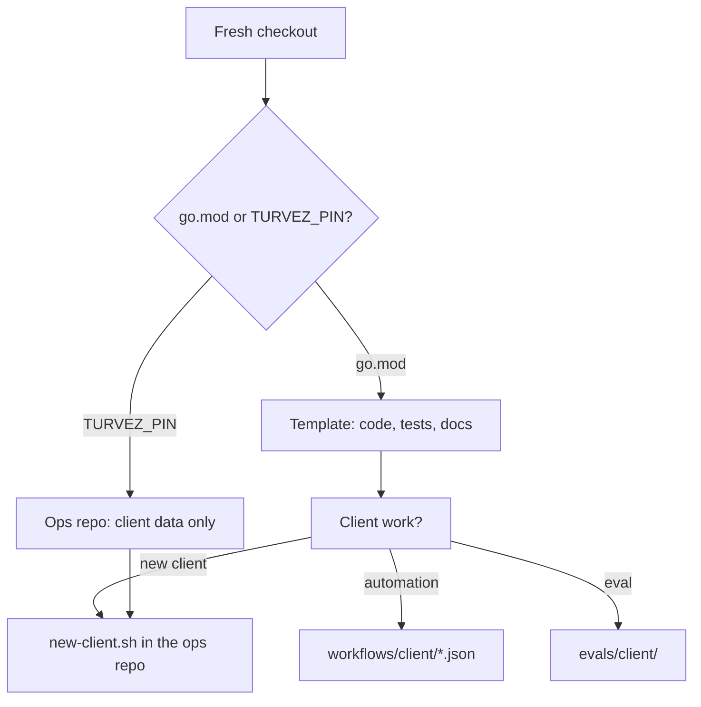
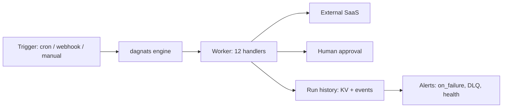
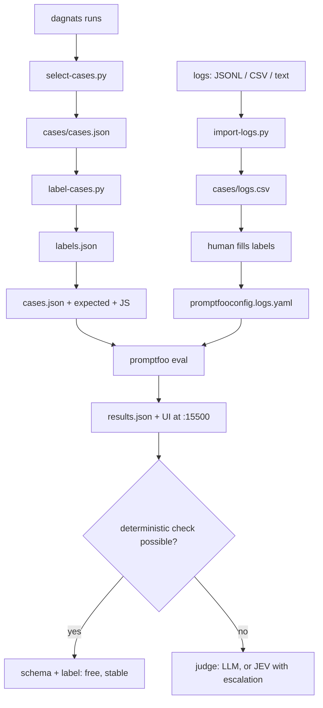
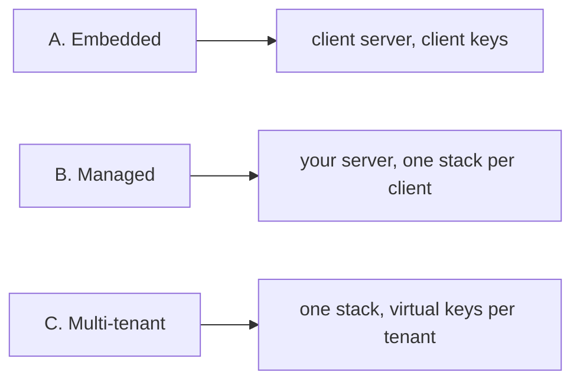

# Workflows

The paths through the repo, as diagrams. GitHub renders Mermaid.

## 1. Which repo am I in, and what am I doing?

`new-client.sh` scaffolds `workflows/<client>/`, `env/<client>.env.example`,
`secrets/<client>/` and `evals/<client>/` in one pass.

## 2. Automation: build, run, observe

A recipe is JSON in `workflows/<client>/`. Git is the source; `workflow
register` puts it in the engine. Every run keeps its input and each step's
output, which is what the eval reads.

## 3. Eval loop: from runs or logs to a measured dataset

Use the run path when the automation already calls a model: production output
becomes a *suggestion*, not a label. Use the logs path when the client has only
inputs: labels are human from the start.

## 4. Deployment profiles

Details and gateway placement: `docs/deployment-profiles.md`.

## Formats: pick by role, not by taste

| Role | Format | Why |
|---|---|---|
| Raw logs to import | **JSONL**, CSV, plain text | JSONL is the common structured-log shape; one record per line, streams without loading everything |
| Generated cases | **JSON** (`cases/cases.json`) | machine output from `select-cases.py`; never hand-edited |
| Hand-written cases | **YAML** (`curated.yaml`) | comments, multi-line text, per-case assertions |
| Label worksheet | **CSV** (`logs.csv`) | spreadsheets; one row per input, empty `expected_category` |
| Labels for generated cases | **JSON** (`labels.json`) | script-owned map keyed by input hash |
| Promptfoo config | **YAML** | native format, supports comments |
| Per-client eval config | **JSON** (`eval.config.json`) | small, parsed by the scripts without extra dependencies |
| Results | **JSON** + HTML | machine-readable and human-readable |

In short: **JSONL for machine logs, CSV for human tables, YAML for authored
text, JSON for generated artifacts.** promptfoo accepts all of them, so the
choice is about who edits the file and how it diffs, not compatibility.
